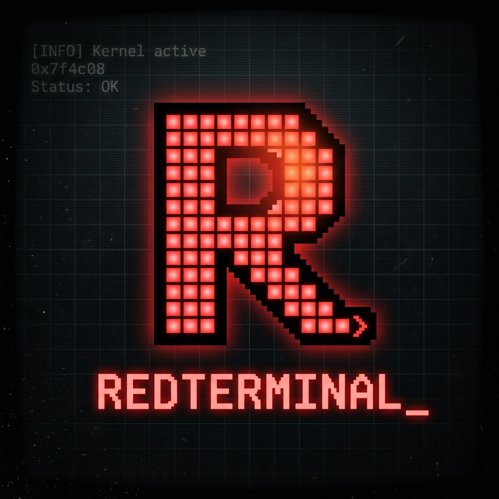
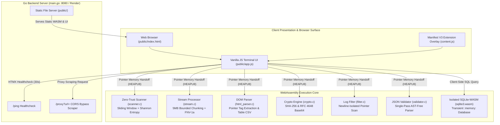
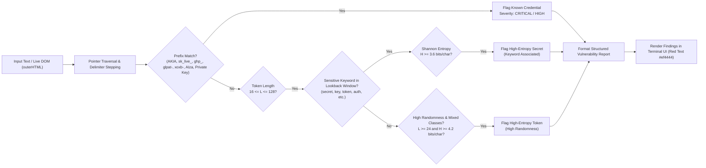
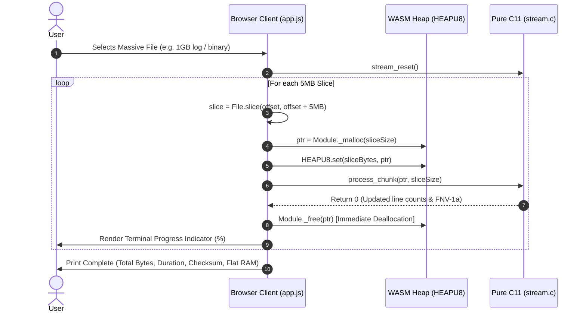

<p align="center">
  
</p>
<h1 align="center">RedTerminal</h1>
<p align="center">
  A high-performance C-dominant security analysis, data crunching, and WebAssembly execution workstation operating directly in the browser and as a toggleable Manifest V3 overlay extension.
</p>

<p align="center">
  <a href="https://redterminal.onrender.com"><strong>Live Web Terminal (Render)</strong></a>
  &bull;
  <a href="https://voxion-labs.github.io/RedTerminal/"><strong>GitHub Pages Deployment</strong></a>
  &bull;
  <a href="https://github.com/Voxion-Labs/RedTerminal/issues"><strong>Telemetry & Issues</strong></a>
</p>

---

## Overview

RedTerminal is a dual-surface systems and security environment engineered with a **strictly C-dominant architecture**. Rather than running heavy business logic in JavaScript, RedTerminal treats JavaScript exclusively as a "dumb pipe" for raw I/O and display rendering. All computation, pointer-based token parsing, cryptographic hashing, and tabular transformations execute inside pure C11 compiled to WebAssembly (WASM).

RedTerminal deploys both as a standalone web application served by a lightweight Go backend and as an injectable Manifest V3 browser extension overlay for Chromium and Firefox.



---

## Problems RedTerminal Solves

### 1. Client-Side Credential Exposure & Leaked Secrets
Modern single-page applications and web APIs frequently leak sensitive API tokens, cloud keys, and private credentials directly into DOM trees, script bundles, or configuration payloads. Traditional security scanners require uploading proprietary source code or logs to third-party SaaS servers, introducing compliance violations and privacy risks. RedTerminal performs **zero-trust secret scanning 100% client-side** using pure C pointer arithmetic and Shannon entropy calculation without transmitting a single byte to external servers.

### 2. Browser Memory Exhaustion on Massive Files
Uploading or parsing multi-hundred-megabyte or gigabyte-scale datasets in the browser normally causes out-of-memory tab crashes due to monolithic JavaScript string and ArrayBuffer buffering. RedTerminal enforces a **bounded 5MB slice streaming pipeline** with the browser's `File.slice()` API. Each 5MB chunk is transferred to WASM linear memory, processed by a pure C engine, and immediately freed via `Module._free()`, maintaining a strictly flat $\le 5\text{MB}$ RAM footprint regardless of file size.

### 3. Infrastructure Friction for Tabular Data Analysis
Querying CSV files with SQL typically requires spinning up database servers (PostgreSQL/MySQL), setting up Docker containers, or uploading data to third-party cloud spreadsheet services. RedTerminal provides an **ephemeral in-memory CSV-to-SQL cruncher** powered by a standalone `sqlite3.wasm` drop-in. It provisions a `:memory:` database inside WebAssembly that executes standard SQL queries client-side and vanishes completely the moment the browser tab is closed.

### 4. Webpage Scraping and DOM Clutter
Web pages are laden with ad tracking scripts and complex nested structures. RedTerminal combines a server-side Go CORS-bypass proxy with pure C pointer parsing to scrape any URL, isolate tables into RFC 4180 CSV files, and filter ad blocks without overhead from heavy JavaScript DOM parsers.

---

## Key Use Cases

- **Client-Side Security Auditing:** Scan live web pages, codebase snippets, or API responses for exposed credentials (`AKIA` for AWS, `sk_live_` for Stripe, `ghp_` for GitHub, Slack tokens, private keys, and high-entropy strings).
- **Ephemeral & Private Data Crunching:** Query sensitive internal, financial, or medical CSV files with standard SQL (`SELECT`, `JOIN`, `GROUP BY`, `WHERE`) with zero disk footprint and zero server telemetry.
- **Massive Dataset Ingestion:** Stream multi-gigabyte log dumps and binary files through WebAssembly with real-time UI progress indicators and flat RAM usage.
- **In-Browser Web Scraping:** Scrape external sites through the Go CORS proxy and pipe raw HTML directly into the C filter or secret scanner (`fetch <url> | filter <kw>` or `fetch <url> | scan`).
- **DevTools Browser Overlay:** Toggle RedTerminal on any active webpage via the Manifest V3 browser extension to audit DOM nodes, extract tables into downloadable CSVs, and purge tracking scripts.

---

## Architecture & Core Concepts

### 1. C-Dominant Architecture ("JS as a Dumb Pipe")
The JavaScript layer (`public/app.js`, `content.js`) is strictly isolated to user interface events, terminal rendering, and pointer passing. All computational logic is written in standard C11 and compiled to WebAssembly:
- Text filtering, tag extraction, and credential matching operate directly on byte pointers (`const char *p`).
- No external regex engines are used; all pattern matching is performed using state-machine pointer arithmetic and Shannon entropy.
- When results are computed, the C engine returns an allocated memory address (`char*`) that JavaScript reads via `Module.UTF8ToString(ptr)` before deallocating with `Module._free(ptr)`.

### 2. Zero-Trust Secret Scanner (Sliding Window & Shannon Entropy)
The scanner (`src/scanner.c`) analyzes character streams through a multi-tier sliding window:



Shannon entropy is evaluated across candidate tokens without third-party math libraries:
$$H = -\sum_{i=0}^{255} P(c_i) \log_2 P(c_i)$$
Tokens with high character diversity preceded by sensitive assignment keywords (`secret=`, `key=`, `token=`, `auth=`) or possessing high entropy ($H \ge 4.2$) across mixed character sets are flagged as vulnerabilities and printed directly in **red text** (`#ef4444`) in the terminal UI.

### 3. Bounded 5MB Stream Chunking Pipeline
For massive file uploads, RedTerminal slices files into strictly 5MB segments:



At any point during processing, the active WebAssembly heap footprint is bounded by the size of a single slice ($\le 5\text{MB}$), preventing browser memory ballooning.

### 4. Transient In-Memory SQLite-WASM Engine
The SQL engine utilizes a precompiled, zero-dependency `sqlite3.wasm` drop-in served directly from `public/`:
- Ingested CSV files are parsed client-side compliant with RFC 4180.
- Column types are inferred (`INTEGER`, `REAL`, `TEXT`) and loaded into an isolated `:memory:` database instance (`new sqlite.oo1.DB(':memory:', 'c')`).
- Queries execute completely in-memory with zero disk persistence and zero host server connections.
- The entire database instance and all associated temporary tables vanish completely when the tab or window closes.

---

## Detailed Technical Documentation & Commands

To keep this document focused on system architecture and capabilities, detailed specifications and CLI usage instructions are maintained in dedicated reference documents accessible from any device or browser:

- [**Commands Reference (`demo/commands.md`)**](demo/commands.md): Complete index of all native CLI commands, WebAssembly terminal commands (`scan`, `query`, `upload`, `extract-tables`, `nuke-ads`, `filter`, `b64`, `hash`, `check`), argument syntax, and execution flows.
- [**Architecture Deep Dive (`demo/architecture.md`)**](demo/architecture.md): Full technical breakdown of memory models, Emscripten linear memory handoff layouts, native POSIX multithreaded scheduler specifications, and process state machines.

---

## Deployment & Build

RedTerminal is live at [**redterminal.onrender.com**](https://redterminal.onrender.com). It runs as a stateless Docker container defined in [`Dockerfile`](Dockerfile) and orchestrated via [`render.yaml`](render.yaml).

### Build Directives

#### 1. Compile Native POSIX Binary
```bash
make
```
Compiles the `redterm` native executable for process lifecycle management and POSIX thread scheduling.

#### 2. Run Test Suites
```bash
# Run native C test binaries
make test

# Run JavaScript & WebAssembly regression tests
node tests/test_secret_scanner.js
node tests/test_stream_chunking.js
node tests/test_csv_sql.js
node tests/test_extension.js

# Run Go server unit tests
go test -v ./...
```

#### 3. Compile WebAssembly Modules
```bash
make build-wasm
```
Compiles all C sources in `src/` via Emscripten (`emcc`) into `public/redterm.js` and `public/redterm.wasm`.

#### 4. Run Web Application
```bash
make run
# Starts Go backend server on http://localhost:8080
```

---

## License

RedTerminal is licensed under the custom [**Voxion Labs Proprietary Research License (VL-PRL)**](LICENSE). See the full terms, operational parameters, and grant of access in the [LICENSE](LICENSE) file.

---
<div align="center">
  (c) 2026 Voxion Labs & Rudranarayan Jena
</div>
<p align="center">
  Zero-Backend &bull; WebAssembly &bull; C11 &bull; SQLite-WASM &bull; Zero-Trust Security
</p>
