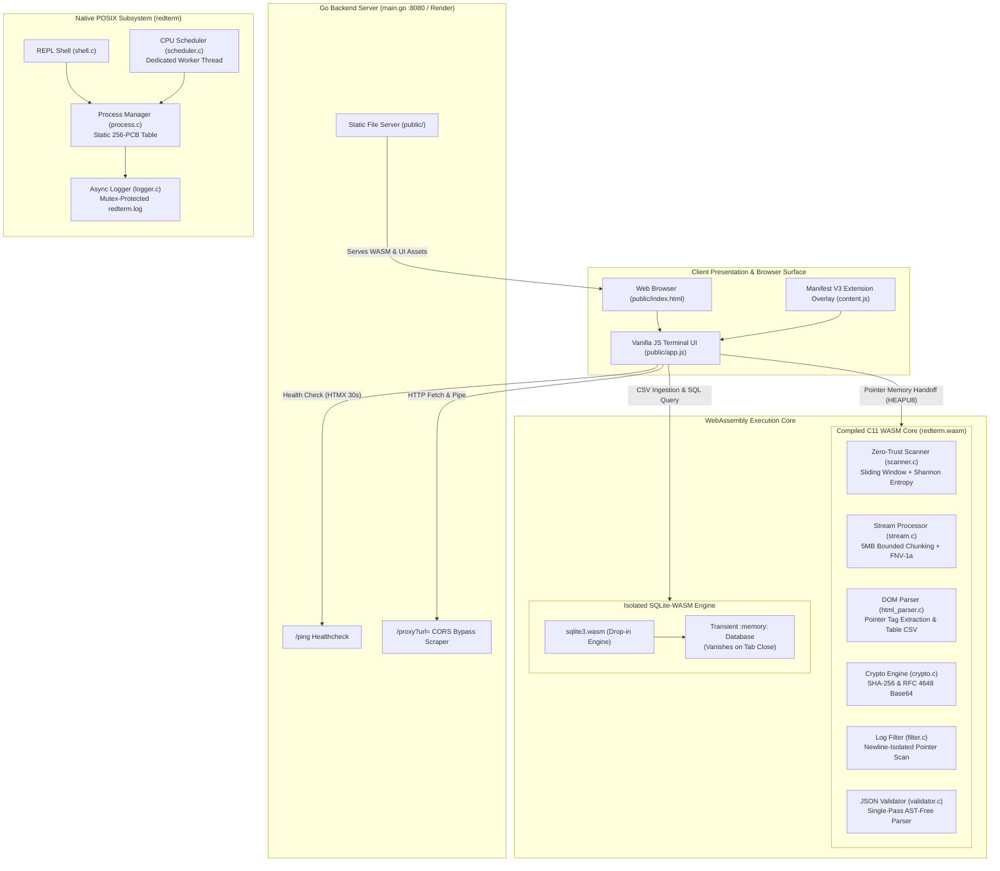
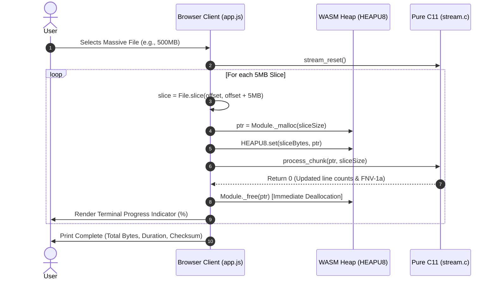

# RedTerminal Architecture

RedTerminal is structured as a dual-target systems environment. It operates natively as a POSIX-compliant C executable for operating system process lifecycle simulation and compiles to WebAssembly (WASM) via Emscripten for client-side execution, backed by a Go standard library HTTP service deployed live at [redterminal.onrender.com](https://redterminal.onrender.com).

---

## System Architecture Diagram



---

## Module Specifications

### 1. Operating System Subsystems (Native & Shared)

| Module | Files | Responsibility | Concurrency & Data Structures |
| :--- | :--- | :--- | :--- |
| **Process Manager** | `include/process.h`<br>`src/process.c` | Tracks process control blocks (PCBs) and enforces state transitions. | Static table of 256 `pcb_t` records; synchronised via `pthread_mutex_t pt_mutex`. |
| **Scheduler** | `include/scheduler.h`<br>`src/scheduler.c` | Simulates CPU time distribution in 1-second intervals. | Spawns a background worker thread (`pthread_create`); increments CPU time of active `RUNNING` records. |
| **Logger** | `include/logger.h`<br>`src/logger.c` | Thread-safe asynchronous event logging to `redterm.log`. | Guarded by `log_mutex`; writes formatted ISO-like timestamps with severity levels (`INFO`, `WARN`, `ERROR`). |
| **Native Shell** | `include/shell.h`<br>`src/shell.c` | Interactive command-line REPL for the native binary. | Standard I/O tokenisation via `fgets` and string manipulation; drives process management calls. |
| **Core Utilities** | `include/utils.h`<br>`src/utils.c` | String sanitisation, PID parsing, and mock buffer processing. | Pure C helper functions and exported `process_data` WASM hook. |

### 2. High-Performance WASM Processing Subsystems

| Module | Files | Responsibility | Algorithmic Complexity |
| :--- | :--- | :--- | :--- |
| **Zero-Trust Scanner** | `include/scanner.h`<br>`src/scanner.c` | Sliding window detection of exposed secrets (AWS, Stripe, GitHub, Slack) and high-entropy keys. | $O(N)$ sliding window pointer traversal with bounded lookback and Shannon entropy calculation ($-\sum p \log_2 p$). Zero external regex libraries. |
| **Stream Chunk Processor** | `include/stream.h`<br>`src/stream.c` | Ingests arbitrary gigabyte-scale datasets in bounded 5MB chunks. | $O(1)$ memory allocation overhead; constant-time pointer stepping per chunk; rolling 32-bit FNV-1a checksum. |
| **HTML Parser & Extractor** | `include/html_parser.h`<br>`src/html_parser.c` | Pure C pointer scanning to extract specific tags and convert `<table>` structures to RFC 4180 CSV. | $O(N)$ single-pass pointer traversal; operates directly on `document.documentElement.outerHTML` with zero JS DOM-query overhead. |
| **In-Memory SQL Cruncher** | `public/sqlite3.wasm`<br>`public/sqlite3.js` | Full relational SQL engine executing queries against ephemeral CSV tables. | Precompiled zero-dependency WebAssembly SQLite engine operating strictly in `:memory:`; zero disk persistence. |
| **Log Filter** | `include/filter.h`<br>`src/filter.c` | High-speed substring line filtering over raw text buffers. | $O(N)$ single-pass pointer traversal strictly bounded by `\n` line delimiters. |
| **Cryptographic Engine** | `include/crypto.h`<br>`src/crypto.c` | RFC 4648 Base64 encoding/decoding and FIPS 180-4 SHA-256 hashing. | Zero external dependencies; 32-bit word operations; 64-round compression loop with static lookup tables. |
| **JSON Validator** | `include/validator.h`<br>`src/validator.c` | Structural verification of massive JSON streams. | $O(N)$ single-pass bracket/brace balance and quote escape tracking; reports 1-based error line numbers without heap AST allocation. |

### 3. Transport, Presentation, and Extension Layer

| Component | Path | Function |
| :--- | :--- | :--- |
| **Go Web Server & CORS Proxy** | `main.go` | Go standard library HTTP file server (`:8080`) routing static assets, handling `/ping` health checks, and providing `/proxy?url=` CORS-bypassing scraping. |
| **Terminal Client** | `public/index.html`<br>`public/app.js` | Zero-dependency terminal emulator handling raw key events, history navigation, ANSI rendering, and Emscripten WASM memory bridge (`HEAPU8`). |
| **Extension Overlay** | `manifest.json`<br>`content.js`<br>`background.js` | Cross-browser Manifest V3 extension injecting RedTerminal as an isolated Shadow DOM overlay on any active webpage. |
| **HTMX Polling** | `public/index.html` | Background heartbeat verification issuing `GET /ping` requests every 30 seconds to confirm server availability. |

---

## Memory Architecture & WASM Boundary

Communication between the JavaScript runtime and compiled C code traverses Emscripten's linear memory boundary:

```text
JavaScript Host Memory                             WASM Linear Memory (HEAPU8)
+-----------------------+                         +-----------------------------------+
| ArrayBuffer / String  |                         |  0x00000000 - 0x00010000 (Static) |
+-----------+-----------+                         +-----------------------------------+
            |                                     |  0x00010000 - Heap Start          |
            | 1. Module._malloc(byte_size)        |                                   |
            +------------------------------------>|  Allocated Input Buffer (inPtr)   |
            | 2. HEAPU8.set(uint8Array, inPtr)    |  [Raw Bytes / String Payload]     |
            |                                     +-----------------------------------+
            | 3. Module.ccall(func, outPtr)       |                                   |
            |------------------------------------>|  Allocated Output Buffer (outPtr) |
            | 4. HEAPU8.subarray(outPtr, len)     |  [Filtered Lines / Hash / etc.]   |
            |<------------------------------------+-----------------------------------+
            | 5. Module._free(inPtr, outPtr)      |
            +------------------------------------>|  Buffer Returned to Allocator     |
+-----------v-----------+                         +-----------------------------------+
| Blob / String Output  |
+-----------------------+
```

1. **Allocation:** The host allocates required byte lengths inside WebAssembly linear memory using exported `_malloc`.
2. **Transfer:** Input data is copied into `Module.HEAPU8` at the target pointer address.
3. **Execution:** Exported C functions execute against raw pointers using strict pointer arithmetic.
4. **Extraction:** The host reads resulting byte buffers directly from `Module.HEAPU8` (or translates UTF-8 strings via Emscripten runtime helpers).
5. **Deallocation:** The host releases both input and returned output buffers using `_free` immediately after each chunk to maintain a flat memory footprint.

---

## Stream Chunking Pipeline (Flat 5MB Memory Model)



---

## Process State Machine (Native POSIX Engine)

The native process scheduler enforces deterministic state transitions:

```text
               +----------------+
               |     start      |
               +-------+--------+
                       |
                       v
                [   RUNNING    ] <-----+
                 |            ^        |
           pause |            | resume |
                 v            |        |
                [   STOPPED    ]       |
                 |                     |
            kill |                     |
                 v                     |
                [  TERMINATED  ]       |
                 |                     |
                 +---------------------+
                 (Permanent Zombie State)
```

| Transition | Initial State | Terminal State | Constraint / Behavior |
| :--- | :--- | :--- | :--- |
| `start <name>` | None | `RUNNING` | Allocates new PCB entry; assigns monotonic PID. Rejects if PCB table exceeds 256. |
| `pause <pid>` | `RUNNING` | `STOPPED` | Halts scheduler CPU accumulation for target process. Rejects if already stopped or terminated. |
| `resume <pid>` | `STOPPED` | `RUNNING` | Restores process to active scheduling queue. Rejects if not stopped. |
| `kill <pid>` | `RUNNING` or `STOPPED` | `TERMINATED` | Marks process as terminated. Retains entry for historical telemetry; permanently halts execution. |
